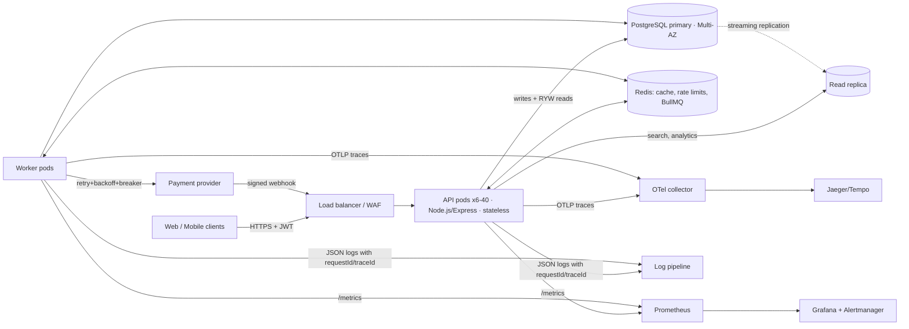
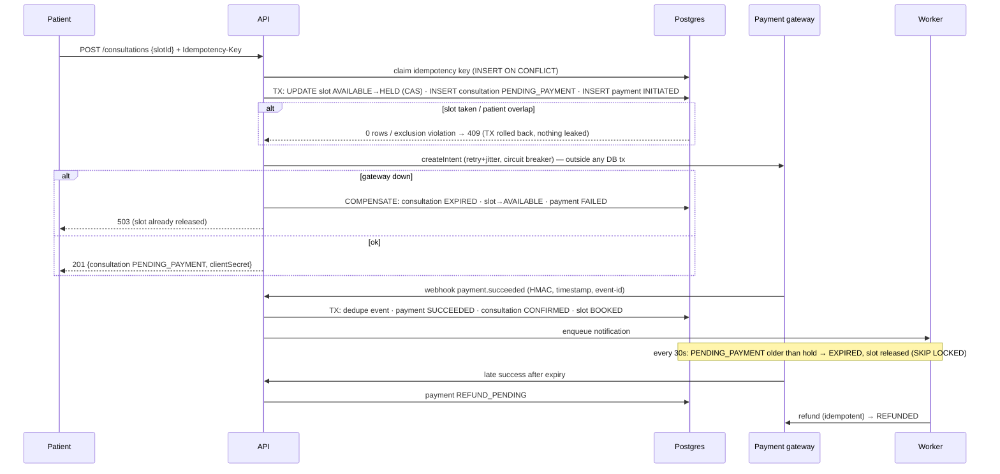
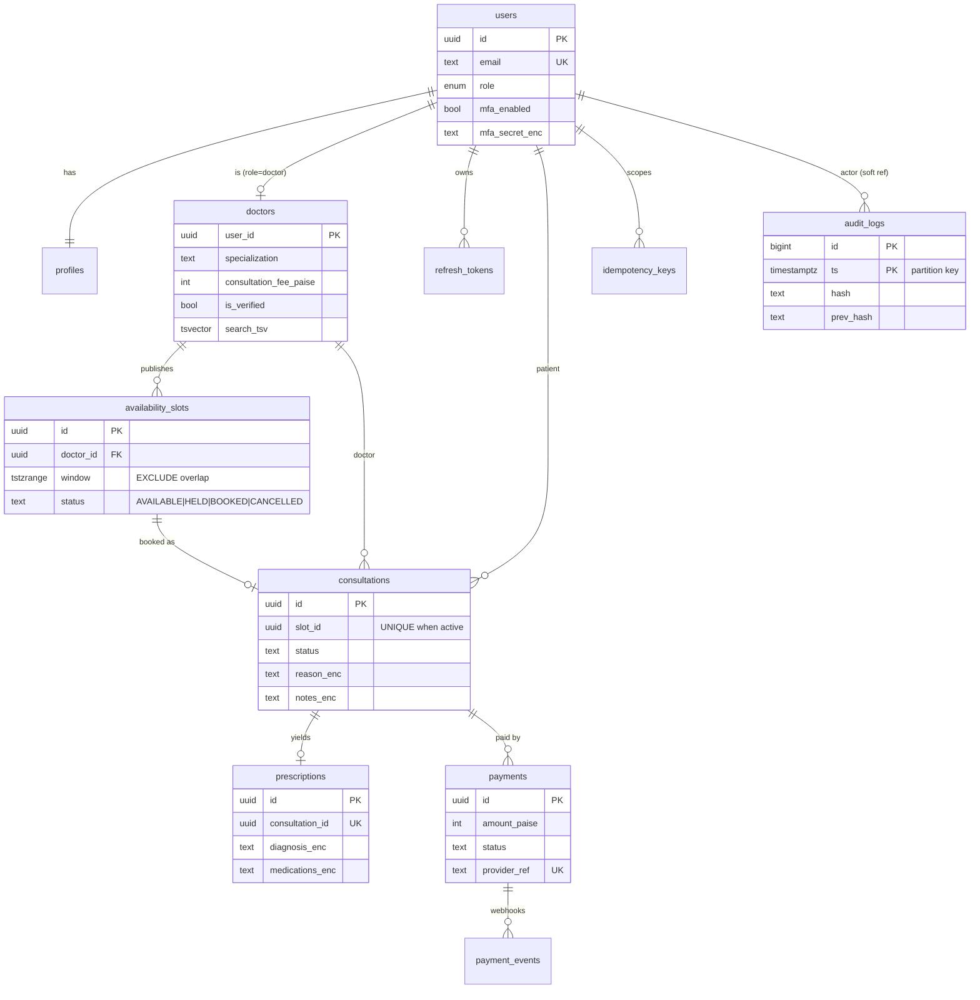

# Amrutam Telemedicine Backend: Architecture

**Targets:** 100k consultations/day · p95 < 200 ms reads / < 500 ms writes · 99.95% availability · encryption, MFA, RBAC · metrics/logs/traces.

## 1. High-level architecture and data flow

* **Stateless API** (modular monolith: `auth, doctors, consultations, prescriptions, search, admin, payments`) with manual constructor DI in `src/container.js`; every module receives its dependencies explicitly, so tests substitute the payment gateway or config. The monolith is split along these module seams if a team boundary ever demands it.
* **Postgres is the source of truth**; every business invariant is also a DB constraint (exclusion, partial unique), so correctness never depends on application timing.
* **Redis is optional/best-effort**: cache, rate-limit counters, BullMQ. If Redis is down, caching and rate limiting fail open, jobs fall back to the DB-driven sweepers; the API stays correct.
* **Async work** (refunds, notifications, hold expiry, no-show sweep, partition maintenance, idempotency purge) runs in separate worker pods (BullMQ: 5 attempts, exponential backoff, failed-set as dead-letter).

## 2. Booking flow (saga with compensation)

**Double-booking defence in depth:** (1) atomic compare-and-set `UPDATE … WHERE status='AVAILABLE'`; (2) `UNIQUE (slot_id) WHERE status active` on consultations; (3) `EXCLUDE` constraint preventing overlapping slots per doctor; (4) `EXCLUDE` preventing a patient holding overlapping consultations. Verified by a 12-way concurrent-booking test.

## 3. ER diagram

## 4. API
REST, versioned `/api/v1`, full contract in `openapi.yaml` (served at `/docs`). Zod validation on every input (strict: unknown fields rejected), keyset pagination, uniform error envelope with `requestId`.

## 5. Retry and backoff
| Where | Policy |
|---|---|
| Payment gateway calls | 3 retries, full-jitter exponential (100 ms → 1.5 s) on transient errors only; circuit breaker opens after 5 consecutive failures (15 s cool-down); then saga compensation |
| DB transactions | retried on `40001` serialization / `40P01` deadlock (3×, 20–300 ms jitter) |
| BullMQ jobs | 5 attempts, exponential from 1 s, failures retained for inspection |
| Webhooks (inbound) | provider redelivers on non-2xx; handler is idempotent via `payment_events(event_id)` and rolls back dedupe on failure |
| Clients | `Idempotency-Key` makes retrying any write safe |

## 6. Data partitioning and scale
* 100k consultations/day ≈ 1.2/s average, ~15/s peak ⇒ ~50–100 writes/s including payments/audit; one Postgres primary (r6g.2xlarge) has >10× headroom. Reads (search, slots, analytics) dominate and go to replicas + Redis.
* `audit_logs` is **range-partitioned by month** (the highest-volume table; partitions pre-created by a job, old partitions detached/archived to S3 for retention without table bloat).
* `consultations` (~36M rows/yr): indexed for access paths (patient/doctor + keyset, partial indexes on hot statuses). Growth plan: range-partition by `scheduled_start` per quarter when >200M rows (the partial unique index already includes the slot, which determines the time); tenant/region sharding by `doctor_id` hash is the next step beyond that.
* Partial indexes keep hot indexes small (`AVAILABLE` slots, `PENDING_PAYMENT`, verified doctors).

## 7. Caching and concurrency
* **Search results** 30 s TTL and **slot lists** 15 s; invalidation by **version counters** (`bump('search')` on any booking/slot change) so no key scans; TTL jitter ±10% and **single-flight** loader prevent stampedes.
* Authorised/PHI data is never cached. Public endpoints send `Cache-Control: public, max-age=15`.
* Concurrency: row-level CAS and constraints, `FOR UPDATE` on consultations/payments in webhook and cancel paths, `FOR UPDATE SKIP LOCKED` for sweepers so many workers never collide, atomic refresh-token rotation.

## 8. Transactions and sagas
Local ACID transactions for each step; the cross-system flow (DB ⇄ payment provider) is an **orchestrated saga** with explicit compensations (`compensateTx`: consultation → EXPIRED/CANCELLED, slot → AVAILABLE, payment → FAILED; late payment → REFUND_PENDING → refund job). Every step is idempotent and guarded by a status precondition, so replays, crashes and duplicate webhooks converge. External calls never happen inside a DB transaction.

## 9. Backup and DR
| | Mechanism | Target |
|---|---|---|
| Intra-region HA | RDS Multi-AZ synchronous standby, auto-failover | RPO 0, RTO ~2 min |
| Corruption/human error | Continuous WAL archiving, PITR 14 days | RPO ≤ 5 min |
| Region loss | Cross-region automated backups (KMS-encrypted) + restore into DR region; app IaC re-deployed there | RPO ≤ 15 min, RTO ≤ 60 min |
| Redis | AOF/replica; treated as disposable (rebuilt from Postgres) | – |
| Audit | Hash chain verified daily (`/admin/audit-logs/verify`); archived partitions are WORM (S3 Object Lock) | – |
| Drills | Quarterly restore test + game-day (kill primary, kill Redis, payment provider outage) | – |

Availability budget for 99.95%: ≈ 22 min/month. Redundant AZs, rolling deploys with `maxUnavailable: 0`, readiness-gated traffic, graceful drain, PDB, and SLO burn-rate alerts (`observability/alerts.yml`).

## 10. Observability
Metrics (`/metrics`: RED per route, DB latency by pool, saga compensations, cache hit ratio, auth events, job outcomes, audit failures), structured JSON logs (pino, secrets/PHI redacted, `requestId` + `traceId` on every line), OpenTelemetry traces (HTTP, pg, ioredis auto-instrumentation) → Jaeger. Grafana dashboard and alert rules provisioned from `observability/`.
