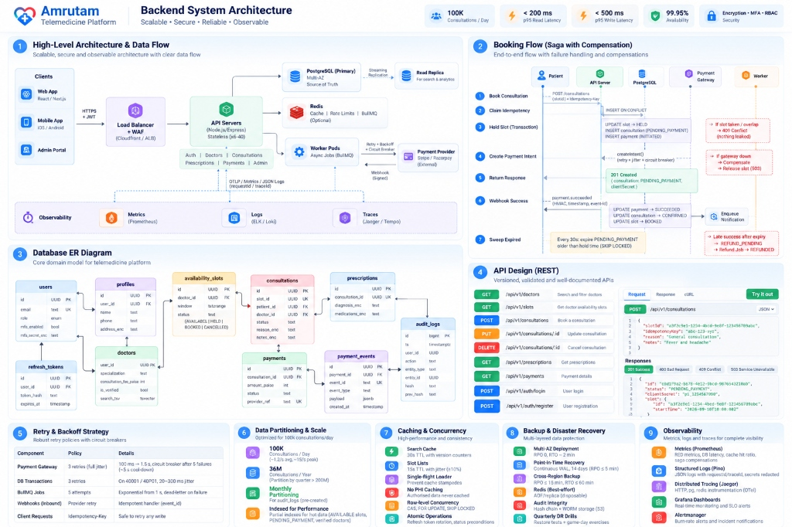
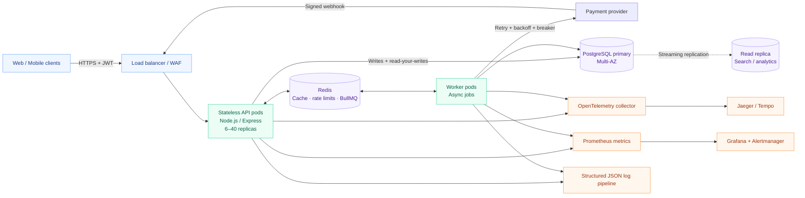
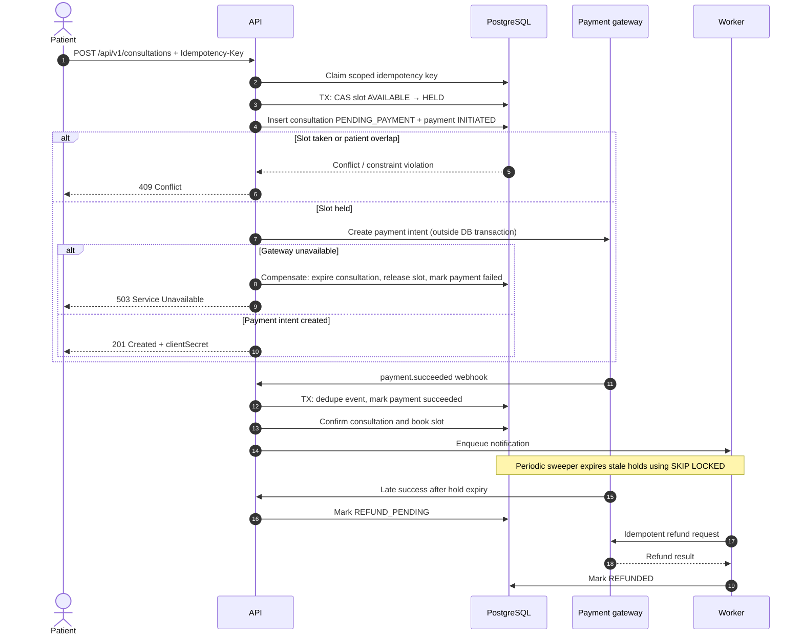
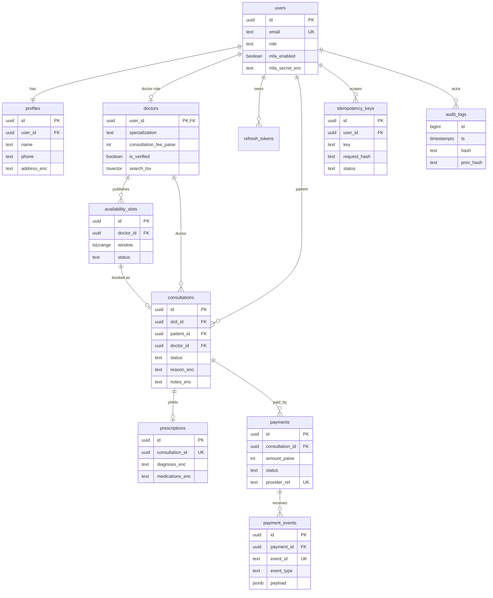
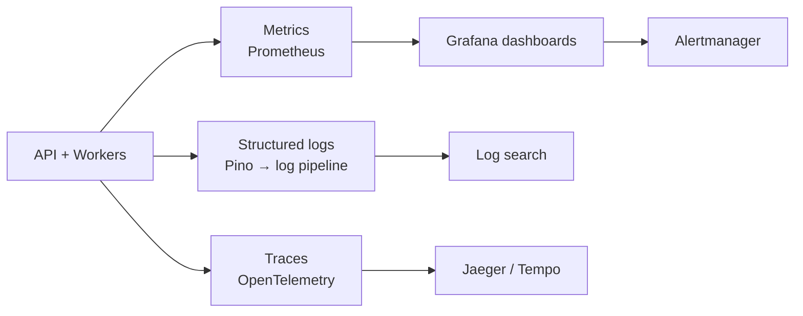

# Amrutam
### Telemedicine Backend Architecture
**Scalable · Secure · Reliable · Observable**

**Design goals:** 100k consultations/day · AES-256-GCM Encryption · TOTP MFA · RBAC · End-to-end Observability

 

---

## Contents
- [01 — Architecture at a glance](#01--architecture-at-a-glance)
- [02 — Booking flow and saga compensation](#02--booking-flow-and-saga-compensation)
- [03 — Data model](#03--data-model)
- [04 — API contract](#04--api-contract)
- [05 — Resilience and retry policy](#05--resilience-and-retry-policy)
- [06 — Data partitioning and scale](#06--data-partitioning-and-scale)
- [07 — Caching and concurrency](#07--caching-and-concurrency)
- [08 — Transactions and sagas](#08--transactions-and-sagas)
- [09 — Backup and disaster recovery](#09--backup-and-disaster-recovery)
- [10 — Observability and operations](#10--observability-and-operations)
- [Security principles](#security-principles)

---

## 01 — Architecture at a glance

> **Core decision:** PostgreSQL is the source of truth. Redis improves performance but is optional and must never be required for business correctness.

### Component responsibilities

| Component | Responsibility | Design choice |
|---|---|---|
| **API** | Auth, doctors, consultations, prescriptions, search, admin, payments | Modular monolith with explicit dependency injection |
| **PostgreSQL** | Durable business state and invariants | Primary is authoritative; constraints enforce correctness |
| **Read replica** | Search and analytics reads | Route only replica-safe reads; preserve read-your-writes on primary |
| **Redis** | Cache, rate limits, BullMQ queue | Best-effort; degrade safely if unavailable |
| **Workers** | Refunds, notifications, hold expiry, no-show sweep, maintenance | Separate worker deployment; retries and failed-job inspection |
| **Observability** | Metrics, logs, traces, alerts | Correlate requests with `requestId` and `traceId` |

**Dependency injection:** `src/container.js` wires modules using manual constructor injection. Tests can replace the payment gateway, configuration, and other dependencies with fakes.

**Redis outage behavior:** Caching and Redis-backed rate limiting fail open gracefully; DB-driven sweepers provide a fallback for scheduled work. A separate edge/WAF protection limit prevents abuse during fail-open intervals.

---

## 02 — Booking flow and saga compensation

### Double-booking defence in depth
1. **Atomic compare-and-set:** Update a slot only when its status is `AVAILABLE`.
2. **Database uniqueness:** Partial unique index prevents multiple active consultations for one slot.
3. **Doctor overlap prevention:** PostgreSQL exclusion constraint (`EXCLUDE USING gist`) protects against overlapping slot ranges.
4. **Patient overlap prevention:** Exclusion constraint prevents overlapping active consultations for a patient.
5. **Concurrency test:** Exercised via a 12-way concurrent booking test proving only 1 booking succeeds and 11 fail cleanly with HTTP 409.

> The database is the final authority on booking invariants. Application-level checks improve error messages but cannot replace constraints.

---

## 03 — Data model

### Data integrity notes
- Foreign keys, `NOT NULL`, `CHECK`, unique indexes, and exclusion constraints guarantee system invariants.
- Payment amounts are strictly integers in paise (avoiding floating-point currency rounding).
- Field-level AES-256-GCM encryption protects sensitive clinical and medical data.
- Idempotency keys are scoped by user and operation, validated with SHA-256 payload hashes.
- Audit logs are range-partitioned by timestamp and cryptographically chained via SHA-256.

---

## 04 — API contract

**Base path:** `/api/v1`  
**Documentation:** `openapi.yaml`, served through Swagger UI at `/docs`  
**Validation:** Zod schemas at every input boundary; reject unknown fields.  
**Pagination:** Keyset/cursor pagination for large result sets.  
**Errors:** Consistent RFC 7807 error envelopes containing a correlation `requestId`.

| Method | Endpoint | Purpose |
|---|---|---|
| `POST` | `/auth/register` | Register patient or doctor |
| `POST` | `/auth/login` | Authenticate and issue tokens |
| `POST` | `/auth/refresh` | Rotate refresh token with reuse detection |
| `GET` | `/doctors` | Search and filter verified doctors |
| `GET` | `/doctors/:id/availability` | Retrieve available slots |
| `POST` | `/consultations` | Create a booking attempt (Saga) |
| `GET` | `/consultations/:id` | Read consultation details & status |
| `POST` | `/consultations/:id/cancel` | Cancel booking & trigger compensation |
| `GET` | `/prescriptions/:id` | Retrieve an authorized prescription (AES-256-GCM) |
| `POST` | `/payments/webhook` | Process signed payment events (HMAC-SHA256) |
| `GET` | `/admin/audit-logs/verify` | Verify cryptographic audit-chain integrity |

---

## 05 — Resilience and retry policy

| Operation | Policy | Safety requirement |
|---|---|---|
| **Payment gateway** | 3 retries with full jitter, 100 ms → 1.5 s; breaker opens after 5 consecutive failures, 15 s cooldown | Retry transient failures only; idempotent provider operation |
| **Database transaction** | Up to 3 retries for `40001` (serialization failure) and `40P01` (deadlock), 20–300 ms jitter | Retry the entire atomic transaction |
| **BullMQ jobs** | 5 attempts, exponential backoff starting at 1 s | Failed jobs retained in dead-letter set for inspection |
| **Inbound webhooks** | Provider redelivery on non-2xx | Dedupe by provider event ID; commit dedupe and business change atomically |
| **Client writes** | `Idempotency-Key` (8–128 chars) | Same key and request returns the same logical result |

**Operational rule:** Never hold a database transaction open while waiting for an external payment provider.

---

## 06 — Data partitioning and scale

### Capacity assumptions

| Measure | Planning estimate |
|---|---|
| Consultations/day | 100,000 |
| Average consultation rate | ~1.2/sec |
| Peak consultation rate | ~15/sec |
| Estimated combined writes including payments/audit | ~50–100/sec |
| Annual consultation growth | ~36 million rows/year |

### Storage strategy
- **Audit logs:** Range-partitioned monthly (`audit_logs_yYYYYmMM`); pre-created by background jobs and archived to S3 WORM storage.
- **Consultations:** Indexed on patient/doctor access paths and hot statuses; evaluated for quarterly range partitioning when rows exceed 200M.
- **Search and availability:** Partial indexes for verified doctors, available slots, and pending-payment records.
- **Read scaling:** Replica routing for search and analytics queries; consistency-sensitive reads routed to primary.

---

## 07 — Caching and concurrency

| Data / operation | Strategy |
|---|---|
| Doctor search | 30 s TTL |
| Availability lists | 15 s TTL |
| Cache expiry | ±10% TTL jitter to avoid synchronized expirations |
| Cache stampede control | Single-flight request coalescing |
| Invalidation | Version counters (`bump('search')`); avoid O(N) key scans |
| Sensitive clinical data | **Never** cached in shared Redis |
| Slot booking | Atomic compare-and-set + database constraints |
| Webhook/cancel paths | Row-level locking (`FOR UPDATE`) |
| Expiry sweepers | `FOR UPDATE SKIP LOCKED` for concurrent conflict-free workers |
| Refresh tokens | Atomic rotation and replay detection |

---

## 08 — Transactions and sagas

Each local database transition uses an ACID transaction. The payment flow is an orchestrated saga spanning PostgreSQL and the external payment provider.

| Saga stage | Success transition | Compensation / recovery |
|---|---|---|
| **Hold slot** | Slot `AVAILABLE → HELD` | Release hold if later step fails |
| **Create payment intent** | Payment `INITIATED` | Mark failed and release slot when safe |
| **Payment success** | Payment `SUCCEEDED`; consultation `CONFIRMED`; slot `BOOKED` | If hold expired, mark `REFUND_PENDING` |
| **Refund** | Provider refund succeeds | Retry idempotently; retain failure for operations review |
| **Notify user** | Notification job completes | Retry asynchronously; do not undo a confirmed booking |

---

## 09 — Backup and disaster recovery

| Scenario | Mechanism | Target |
|---|---|---|
| **Intra-region availability** | RDS Multi-AZ synchronous standby and automatic failover | RPO 0; RTO ~2 min |
| **Accidental deletion/corruption** | Continuous WAL archiving and 14-day point-in-time recovery | RPO ≤ 5 min |
| **Region loss** | Cross-region encrypted backups and infrastructure redeployment | RPO ≤ 15 min; RTO ≤ 60 min |
| **Redis loss** | Treat cache/queue as recoverable; rebuild derived state from PostgreSQL | No business-state loss |
| **Audit retention** | Hash-chain verification and S3 Object Lock for archived partitions | Tamper-evident archive |
| **Validation** | Quarterly restore tests and chaos game days | Proof of recovery viability |

### Availability budget
**99.95% availability ≈ 21.6 minutes of downtime per 30-day month.**  
Protected through multi-AZ deployments, readiness probes, graceful connection draining (`server.keepAliveTimeout = 65000`), rolling updates with `maxUnavailable: 0`, and SLO burn-rate alerts.

---

## 10 — Observability and operations

### Golden signals and domain metrics
- **Traffic:** Requests/sec by route and HTTP status.
- **Errors:** 4xx/5xx rates, payment gateway failures, and webhook verification failures.
- **Duration:** p50/p95/p99 latency histograms; PostgreSQL connection pool wait time.
- **Saturation:** Node.js event-loop lag, memory, and database pool utilization.
- **Booking integrity:** Expired holds, slot conflicts, and saga compensations.
- **Audit & Security:** Authentication failures, MFA attempts, refresh token reuse incidents, and SHA-256 chain verification status.

---

## Security principles
- **Identity:** Mandatory TOTP MFA for doctors/admins; short-lived JWT access tokens (15m) and family-tracked refresh tokens.
- **Authorization:** Deny by default; enforce strict RBAC and object ownership checks.
- **Data Protection:** TLS in transit, AES-256-GCM field encryption with row AAD for PHI, and KMS key rotation.
- **Input Hardening:** Strict Zod validation schemas, 100 KB payload limits, rate limiting, and CORS allow-lists.
- **Integrity:** SHA-256 hash-chained immutable audit log with database triggers blocking modifications.

---

### Design Principle

**Correctness in PostgreSQL · Resilience through idempotency · Performance through measured optimization · Trust through observability**

*Amrutam Telemedicine Backend · Architecture & Engineering Design*

