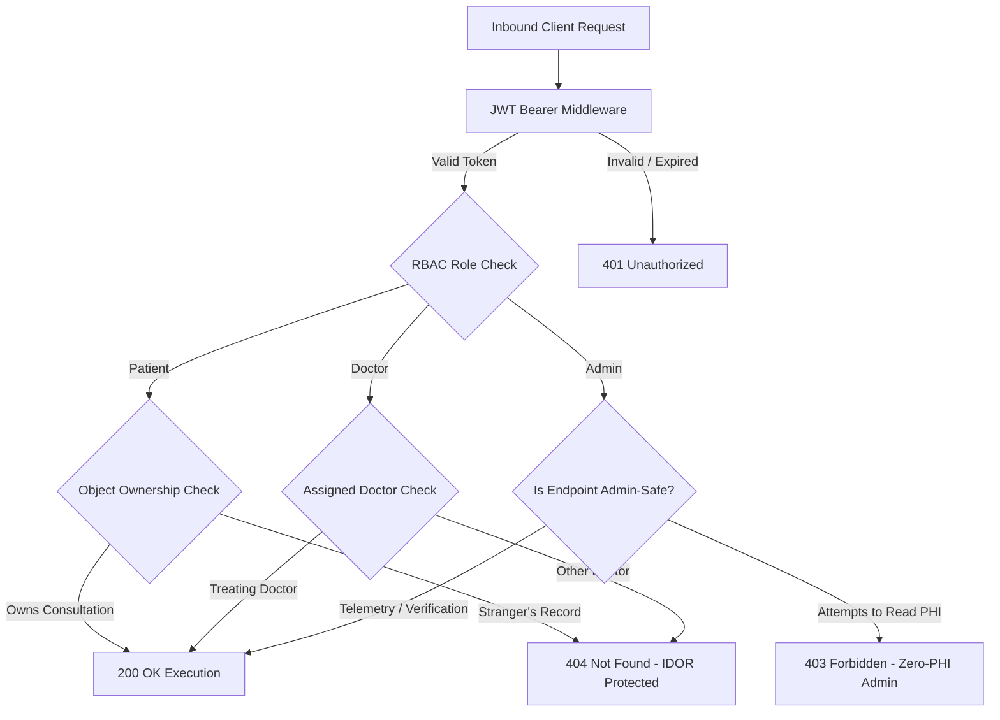
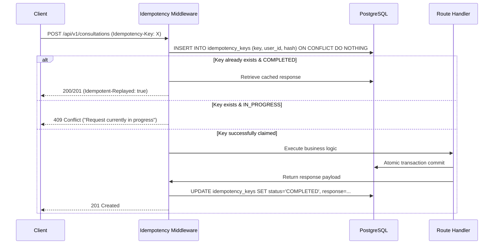
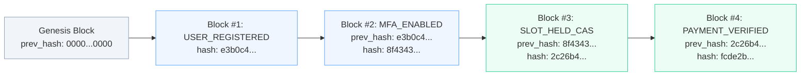

<div align="center">

# Amrutam
### Security Checklist & Compliance Specification
**Zero-Trust · Field-Level Cryptography · Multi-Factor Authentication · Audit Integrity**

[](docs/SECURITY.md)
[](docs/SECURITY.md)
[](docs/SECURITY.md)
[](docs/SECURITY.md)

**Compliance Scope:** HIPAA PHI Safeguards · India DPDP Act Aligned · OWASP Top 10 · Strict Least-Privilege RBAC

</div>

---

## Contents
- [01 — Authentication & Session Security](#01--authentication--session-security)
- [02 — Role-Based Access Control & Authorization](#02--role-based-access-control--authorization)
- [03 — Cryptographic Data Protection & Key Management](#03--cryptographic-data-protection--key-management)
- [04 — OWASP Top 10 Mitigation Matrix](#04--owasp-top-10-mitigation-matrix)
- [05 — Idempotency & Transactional Integrity](#05--idempotency--transactional-integrity)
- [06 — Compliance & Immutable Audit Trails](#06--compliance--immutable-audit-trails)
- [07 — Supply Chain & Infrastructure Hardening](#07--supply-chain--infrastructure-hardening)

---

## 01 — Authentication & Session Security

> **Core Principle:** Passwords are never stored plaintext; privileged roles require non-negotiable two-factor authentication; sessions are short-lived and cryptographically revocable.

### Key Controls & Defenses

| Security Layer | Implementation Detail | Architectural Protection |
|---|---|---|
| **Password Hashing** | `bcryptjs` with cost factor 12 | Adaptive salted hashing resistant to GPU/ASIC rainbow tables. |
| **User Enumeration Defense** | Constant-time dummy hash on non-existent accounts | Prevents timing attacks determining valid emails during login. |
| **Account Lockout Policy** | 5 consecutive failures triggers a 15-minute freeze | Mitigates automated credential stuffing and dictionary attacks. |
| **MFA Enforcement (RFC 6238)** | Mandatory TOTP for `doctor` and `admin` roles | Privileged users cannot invoke business APIs until TOTP is verified; 8 single-use hashed backup recovery codes provided. |
| **Algorithm Pinning** | Explicit `HS256` verification | Pinned signature verification rejects `alg: none` or asymmetric confusion exploits. |
| **Token Scope Isolation** | 15-minute JWT access tokens; specialized challenge tokens | `mfa_challenge` and `mfa_setup` tokens cannot invoke patient/clinical endpoints. |
| **Refresh Token Family Revocation** | Cryptographic SHA-256 token hashing with family tracking | If an expired or replayed refresh token is used, the **entire token lineage** is revoked immediately. |
| **Immediate Session Revocation** | Centralized user revocation version counters | Disabling a user terminates all active JWT sessions within seconds. |

---

## 02 — Role-Based Access Control & Authorization

> **Core Principle:** Deny by default. Every endpoint verifies role claims, and every data read validates object-level resource ownership.



### Authorization Invariants
1. **IDOR Defense:** When a user queries a consultation or prescription they do not own, the system responds with **`404 Not Found`** rather than `403 Forbidden`, preventing resource ID enumeration.
2. **Zero-PHI Admin Isolation:** Administrators possess platform-level operational visibility (analytics, verification queues, audit streams) but are cryptographically and logically prohibited from accessing patient clinical diagnoses and prescriptions.
3. **Privilege Escalation Prevention:** Self-registration is strictly restricted to `patient` and unverified `doctor`. Administrative accounts cannot be registered via public APIs; strict Zod schemas reject role injection.
4. **Doctor Verification Gate:** Registered doctors remain unlisted and completely unbookable until an authorized administrator verifies their credentials.

---

## 03 — Cryptographic Data Protection & Key Management

### Protected Health Information (PHI) Encryption
All sensitive medical fields—including consultation reasons, clinical notes, prescriptions, diagnosis formulations, and MFA TOTP secrets—are encrypted at rest using authenticated **AES-256-GCM**.

```text
Ciphertext Format:
enc:v1:aes-256-gcm:<base64-iv>:<base64-ciphertext-with-tag>:<aad-context>
```

- **Row-Level AAD (Additional Authenticated Data):** Every ciphertext is bound to its database row ID (e.g., `aad_consultation_id_<uuid>`). An attacker cannot swap encrypted values between database rows without triggering GCM authentication tag mismatch errors.
- **Zero-Downtime Online Key Rotation:** Keys are managed via a versioned keyring (`ENCRYPTION_KEYS={"1":"...", "2":"..."}`). Running `npm run rotate-keys` re-encrypts rows online in batches using the active key ID while preserving historical decryptability.

### Secret Management
- **Zero Secrets in Source Control:** Enforced via `gitleaks` in the CI/CD pipeline.
- **Strict Boot Validation:** In production (`NODE_ENV=production`), the application halts immediately during initialization if cryptographic secrets do not meet 32-character high-entropy requirements.
- **Log Scrubbing:** Pino logging formatters automatically redact passwords, tokens, encryption keys, and patient clinical fields.

---

## 04 — OWASP Top 10 Mitigation Matrix

| OWASP 2021 Threat | System Vulnerability Vector | Architectural Mitigation | Code / Configuration Proof |
|---|---|---|---|
| **A01: Broken Access Control** | IDOR, unauthorized data access, role spoofing | Strict RBAC middleware, object-level ownership checks, admin PHI shielding. | [`src/middleware/auth.js`](../src/middleware/auth.js), [`tests/integration/auth.test.js`](../tests/integration/auth.test.js) |
| **A02: Cryptographic Failures** | Data exposure at rest or in transit | AES-256-GCM field encryption with AAD, TLS 1.3/HSTS headers, bcrypt cost 12. | [`src/lib/crypto.js`](../src/lib/crypto.js), [`scripts/rotate-keys.js`](../scripts/rotate-keys.js) |
| **A03: Injection** | SQL injection, malicious payload execution | 100% parameterized SQL queries via `pg`, strict Zod input parsing. | [`src/db.js`](../src/db.js), [`src/modules/`](../src/modules/) |
| **A04: Insecure Design** | Double booking races, unhandled payment failures | Distributed saga with compensations, database exclusion constraints, threat model. | [`docs/THREAT_MODEL.md`](THREAT_MODEL.md), [`src/modules/consultations/service.js`](../src/modules/consultations/service.js) |
| **A05: Security Misconfiguration** | Information leakage, unsafe server defaults | Helmet security headers, `x-powered-by` disabled, non-root Docker runtime. | [`src/app.js`](../src/app.js), [`Dockerfile`](../Dockerfile) |
| **A06: Vulnerable Components** | Outdated or compromised dependencies | Automated Dependabot, `npm audit` gates in CI, Trivy vulnerability scanning. | [`.github/workflows/ci.yml`](../.github/workflows/ci.yml) |
| **A07: Identification & Auth Failures** | Brute force, credential stuffing, session hijacking | TOTP MFA, 5-attempt account lockout, refresh token family reuse revocation. | [`src/modules/auth/service.js`](../src/modules/auth/service.js) |
| **A08: Software & Data Integrity** | Webhook replay, tampered logs, MITM | HMAC-SHA256 signed webhooks, SHA-256 linear hash-chained immutable audit log. | [`src/audit.js`](../src/audit.js), [`src/modules/consultations/routes.js`](../src/modules/consultations/routes.js) |
| **A09: Security Logging Failures** | Undetected breaches, lost incident history | Centralized audit log with actor IP/ID, Prometheus alert rules on security anomalies. | [`observability/alerts.yml`](../observability/alerts.yml), [`src/audit.js`](../src/audit.js) |
| **A10: Server-Side Request Forgery** | Malicious outbound fetch to cloud metadata | Zero user-controlled URL fetch endpoints; static payment provider adapters. | [`src/modules/payments/gateway.js`](../src/modules/payments/gateway.js) |

---

## 05 — Idempotency & Transactional Integrity

### End-to-End Write Idempotency
All mutating HTTP operations (`POST`, `PUT`, `DELETE`) require a valid `Idempotency-Key` header (8–128 characters).



- **Webhook Deduplication:** Payment webhooks check `payment_events(event_id)` atomically within the transaction to guarantee exactly-once payment processing.
- **Race Prevention:** Slot bookings utilize database-level compare-and-set and partial unique indexes to guarantee zero double bookings.

---

## 06 — Compliance & Immutable Audit Trails

### SHA-256 Linear Hash-Chained Audit Trail
Every system event (logins, MFA enrollment, slot reservations, prescription views, and refunds) records an immutable audit entry.



1. **Database-Level Immutability:** PostgreSQL triggers intercept and abort any `UPDATE` or `DELETE` statement targeting the `audit_logs` table.
2. **Cryptographic Chaining:** Each entry incorporates the SHA-256 hash of its chronological predecessor:
   $$\text{hash}_n = \text{SHA256}(\text{id} \parallel \text{ts} \parallel \text{action} \parallel \text{actor} \parallel \text{prev\_hash})$$
3. **Tamper Detection Endpoint:** `/api/v1/admin/audit-logs/verify` audits the full chain from genesis to head, immediately reporting block-level integrity violations.
4. **Partitioned Archival:** Audit records are partitioned monthly and exported to Amazon S3 Object Lock (WORM storage) for 7-year medical compliance.

---

## 07 — Supply Chain & Infrastructure Hardening

- **Non-Root Execution:** Node.js runs as user `nodejs` (UID 10001) in a hardened Linux container.
- **Network Isolation:** Kubernetes `NetworkPolicy` isolates database and Redis instances so only authorized API and worker pods can initiate connections.
- **Continuous Security Pipeline:**
  - `npm audit` validates all dependencies against the National Vulnerability Database.
  - `Trivy` scans the production container image for OS-level vulnerabilities.
  - `CodeQL` runs static application security testing (SAST) on all PRs.
  - `Gitleaks` enforces zero credential leaks in git history.

---

<div align="center">

### Security Policy

**Defense-in-Depth · Mathematical Verification · Zero-Trust Principles**

*Amrutam Telemedicine Platform · Enterprise Security Architecture*

</div>
