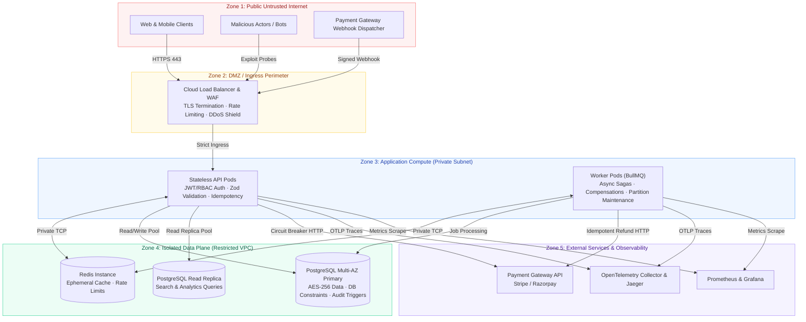
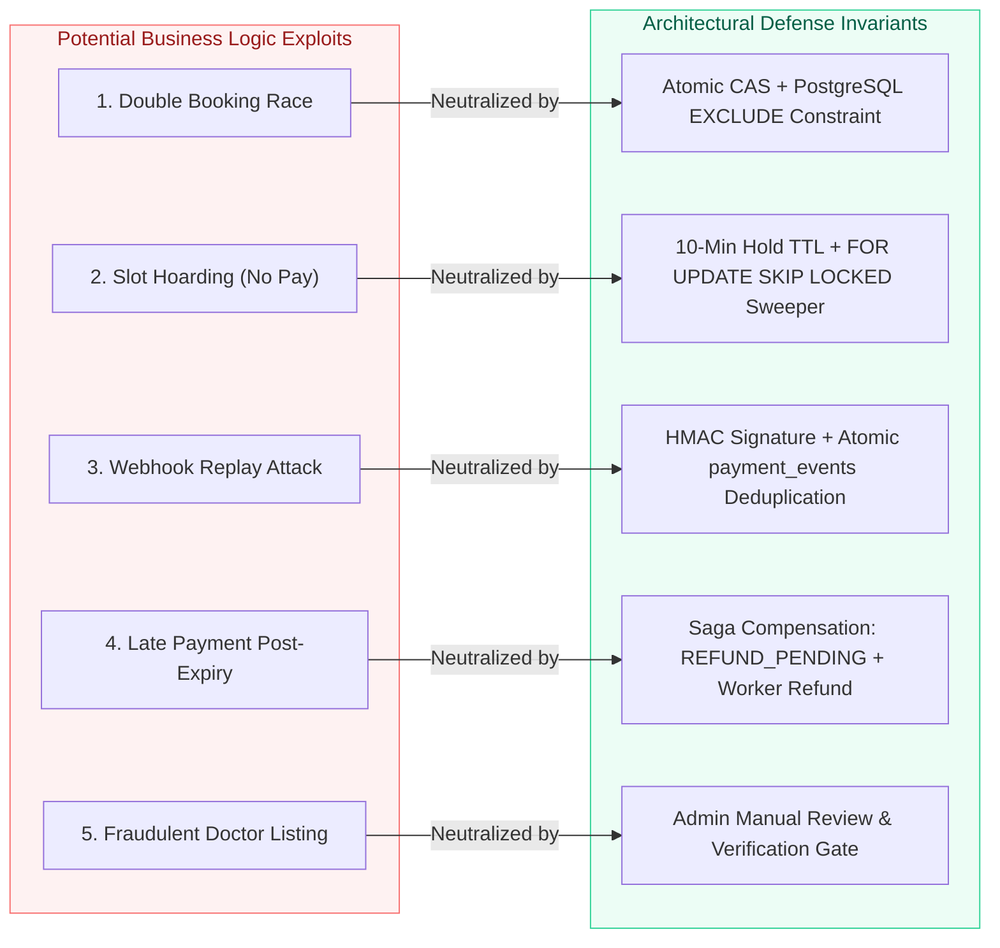

# Amrutam
### Threat Model & Attack Surface Analysis
**STRIDE Methodology · Data Classification · Business-Logic Defense-in-Depth**

**Scope:** Telemedicine Consultation Sagas · Patient Health Information (PHI) · Payment Webhooks · Public Internet Surfaces

---

## Contents
- [01 — Assets & Data Classification](#01--assets--data-classification)
- [02 — Trust Boundaries & Attack Surface](#02--trust-boundaries--attack-surface)
- [03 — STRIDE Threat Matrix & Mitigations](#03--stride-threat-matrix--mitigations)
- [04 — Business-Logic Abuse Scenarios & Defenses](#04--business-logic-abuse-scenarios--defenses)
- [05 — Residual Risks & Architectural Roadmap](#05--residual-risks--architectural-roadmap)

---

## 01 — Assets & Data Classification

> **Core Principle:** Data is categorized by criticality and sensitivity. Highest-tier clinical assets (PHI) receive cryptographic isolation and participant-only access rights.

| Classification Tier | Domain Assets | Security Controls & Storage Rules |
|---|---|---|
| **Restricted (PHI)** | Clinical diagnoses, prescribed Ayurvedic formulations, dosage instructions, patient consultation reason & medical notes. | **AES-256-GCM** field-level encryption with per-row AAD; participant-only access; every read audited with actor ID; never cached in Redis or emitted in logs. |
| **Confidential (PII)** | Patient phone numbers, dates of birth, full names, home addresses, email addresses. | Phone & DOB encrypted at rest; email accessible only to user and system; redacted in all structured logging pipelines. |
| **Secrets & Keys** | Password hashes, refresh tokens, TOTP secrets, JWT signing keys, payment webhook secrets, encryption keys. | Salted bcrypt (cost 12), SHA-256 token hashing, encrypted TOTP secrets; secrets injected solely via environment variables; automated key rotation. |
| **Financial Data** | Payment amounts, settlement statuses, gateway transaction references (`providerRef`). | **Zero PAN storage**; payment processing outsourced to PCI-DSS compliant providers; client never controls payment status. |
| **Internal Data** | Doctor catalog metadata, specialization descriptions, clinic hours, platform analytics KPIs. | Protected by RBAC; search and availability cached in Redis with short TTLs and versioned invalidation. |
| **Integrity-Critical** | Audit event chain, slot booking states, idempotency records. | Append-only PostgreSQL triggers; SHA-256 cryptographic chaining; exclusion constraints preventing duplicate bookings. |

---

## 02 — Trust Boundaries & Attack Surface

### Perimeter Attack Vectors & Mitigations
1. **Public Web Interface (Perimeter 1 → 2):** Exploited via brute force, credential stuffing, and injection. Mitigated by global rate limiters (600/min), strict auth rate limiters (10/min), and account lockout.
2. **Payment Webhook Route (Perimeter 1 → 3):** The only unauthenticated write endpoint. Mitigated by cryptographic HMAC-SHA256 signature verification, replay-preventing timestamp headers, and atomic `payment_events(event_id)` deduplication.
3. **Application to Database (Perimeter 3 → 4):** Prevented from SQL injection via 100% parameterized queries. Zero external network exposure for database instances.

---

## 03 — STRIDE Threat Matrix & Mitigations

| Threat Category | Real-World Attack Scenario | Threat Vector | System Defensive Countermeasure |
|---|---|---|---|
| **S — Spoofing** | Attacker impersonates an authorized doctor or replays payment webhooks. | Stolen session token, forged webhook payload, brute-forced password. | **Mandatory TOTP MFA** for doctor/admin roles; short-lived 15m JWTs; refresh token reuse tree-revocation; HMAC-SHA256 webhook signatures with timestamp validation. |
| **T — Tampering** | Attacker alters appointment fees, modifies another patient's booking, or edits audit logs. | Parameter tampering, direct DB manipulation, webhook payload mutation. | Server-authoritative pricing (never read from client); object ownership verification; database triggers prohibiting `UPDATE`/`DELETE` on audit tables; SHA-256 linear hash chaining. |
| **R — Repudiation** | Doctor claims they never issued a prescription; patient claims they didn't cancel. | Denial of action after occurrence. | Non-repudiable audit logging recording Actor ID, IP address, Timestamp, Action type, and `requestId` anchored in an immutable cryptographic chain. |
| **I — Information Disclosure** | Attacker performs IDOR to read medical prescriptions or sniffs database backups. | Enumerating UUIDs, SQL injection, inspecting plaintext database volumes. | Stranger requests receive **`404 Not Found`**; field-level AES-256-GCM encryption with row-bound AAD; AWS KMS encrypted storage; strict log redaction of PHI. |
| **D — Denial of Service** | Botnet floods doctor search or hoards time slots without completing payments. | High-concurrency slot reservations, query flooding, massive payload posts. | Atomic 10-minute hold window with automated background release sweepers; single-flight Redis cache stampede protection; 100 KB request body limit. |
| **E — Elevation of Privilege** | Patient registers as administrator or modifies JWT algorithm header. | Parameter injection (`role: "admin"`), JWT `alg: none` exploit. | Strict Zod validation schemas rejecting undeclared properties; algorithm pinning (`HS256`); admin accounts require manual DB provisioning; scoped tokens. |

---

## 04 — Business-Logic Abuse Scenarios & Defenses

### Detailed Abuse Analysis
1. **Double Booking Race Condition:** Multiple patients attempt to reserve the same slot at the exact millisecond.
   - *Defense:* Atomic CAS `UPDATE availability_slots SET status='HELD' WHERE id=$1 AND status='AVAILABLE'` + partial unique index on consultations + exclusion constraints on overlapping time windows. Verified by a 12-way concurrent booking test.
2. **Slot Hoarding Attack:** A competitor holds all active doctor slots without paying, blocking legitimate patients.
   - *Defense:* Strict per-user write rate limits (60/min) + hard 10-minute hold window. Background worker sweeps expired holds every 30 seconds using `FOR UPDATE SKIP LOCKED`.
3. **Webhook Replay Attack:** Attacker intercepts a `payment.succeeded` webhook and retransmits it to falsely confirm additional bookings.
   - *Defense:* Webhooks verify timestamp freshness (±300 seconds) and insert into `payment_events(event_id)` with a unique constraint. Duplicate transmissions return 200 without side-effects.
4. **Late Payment After Slot Expiry:** A patient's payment succeeds after their 10-minute hold has expired and the slot was booked by someone else.
   - *Defense:* The saga detects slot unavailability, transitions the payment to `REFUND_PENDING`, and queues an idempotent background refund job.

---

## 05 — Residual Risks & Architectural Roadmap

| Current Residual Risk | Impact Level | Planned Architectural Evolution |
|---|:---:|---|
| **Symmetric Token Verification** | Medium | Migrate from HS256 to asymmetric **RS256 / EdDSA** with automated JWKS key rotation when microservice boundaries split. |
| **Keyring in Environment** | Low | Integrate with **AWS KMS Envelope Encryption** (`GenerateDataKey`) for hardware-managed per-record data keys. |
| **Token Theft Window (15m)** | Low | Implement client device fingerprinting and step-up authentication for sensitive clinical reads. |
| **WAF Intelligence** | Low | Deploy AWS WAF Bot Control and automated rate-based IP blocking for anomaly patterns detected in the audit stream. |

---

### Threat Model Principle

**Anticipate Failures · Constrain Authority · Verify Computationally**

*Amrutam Telemedicine Platform · Security & Threat Engineering*

